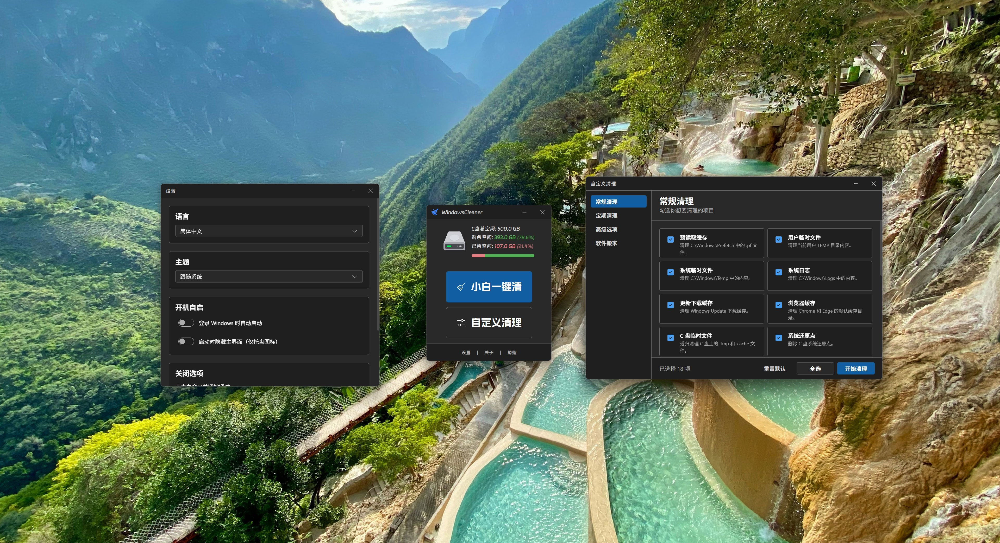

<h1>Windows Cleaner</h1>

[English version](README.en.md)

> [!CAUTION]
>
> #### 🔔 For general questions, please use [Discussions](https://github.com/darkmatter2048/WindowsCleaner/discussions). ***Issues* are for bug reports and feature requests only.**

## Screenshot

## Contributors

## Acknowledgments

Thank you to everyone who supports this open-source project on GitHub and to the organizations and individuals who have helped us.

<table>
  <tr>
    <td>
      
    </td>
    <td>
    Free code signing on Windows provided by <a href="https://signpath.io">SignPath.io</a>, certificate by <a href="https://signpath.org/">SignPath Foundation</a>
    </td>
  </tr>
  <tr>
    <td>
      
    </td>
    <td>
    Special thanks to <a href="https://www.qiaoxh.com/?from=dyblog.online">Qiaoxh</a> for providing free CDN services for dyblog.online through <a href="https://www.devpole.com/?from=dyblog.online">DevPole</a>.
    </td>
  </tr>
  <tr>
    <td>
      
    </td>
    <td>
    Thanks to <a href="https://space.bilibili.com/67079745?from=dyblog.online">Chun199</a> for the video tutorial. Check out the <a href="https://www.bilibili.com/video/BV1VmLozrEDE">video</a>.
    </td>
  </tr>
  <tr>
    <td>
      
    </td>
    <td>
    Thanks to <a href="https://space.bilibili.com/175870152?from=dyblog.online">Yuanlai Ruci</a> for the help. Watch the <a href="https://www.bilibili.com/video/BV1h3gh6aEbJ">video</a>.
    </td>
  </tr>
</table>

## Star History

<a href="https://www.star-history.com/?repos=darkmatter2048%2FWindowsCleaner&type=date&legend=top-left">
 <picture>
   <source media="(prefers-color-scheme: dark)" srcset="https://api.star-history.com/chart?repos=darkmatter2048/WindowsCleaner&type=date&theme=dark&legend=top-left&sealed_token=YcP5zIRg5ZbiDQmF65kGhWYS5iUR_r3kx8GxNaYJ6HX0VEVwn4OyDtxCJQN47Ud4Eu3hLxBZmP2_o2d0nIfz3DWvZAKa8gndcZdF7PuYkila75c64JlkCg" />
   <source media="(prefers-color-scheme: light)" srcset="https://api.star-history.com/chart?repos=darkmatter2048/WindowsCleaner&type=date&legend=top-left&sealed_token=YcP5zIRg5ZbiDQmF65kGhWYS5iUR_r3kx8GxNaYJ6HX0VEVwn4OyDtxCJQN47Ud4Eu3hLxBZmP2_o2d0nIfz3DWvZAKa8gndcZdF7PuYkila75c64JlkCg" />
   
 </picture>
</a>

## Promotional Partners

DaYe recommends the following websites:

<table>
  <tr>
    <td>
      
    </td>
    <td>
    <a href="https://space.bilibili.com/501149848?from=dyblog.online">Mo Zhi</a> is a Bilibili creator covering many topics. Follow for new videos and updates. WeChat: ZHAO15943546500; fan group: 149054683.
    </td>
  </tr>
  <tr>
    <td>
      
    </td>
    <td>
    <a href="https://space.bilibili.com/648765401">TC999</a> is one of the creators who made tutorials for an earlier version of Windows Cleaner. Contact the creator for collaborations or business inquiries.
    </td>
  </tr>
  <tr>
    <td>
      
    </td>
    <td>
    <a href="https://www.sakuraxy.top/?from=dyblog.online">Sakura Night Resource Site</a> shares software resources and updates.
    </td>
  </tr>
  <tr>
    <td>
      
    </td>
    <td>
    <a href="https://lcgf.xyz/?from=dyblog.online">LCGF OPC</a> explores AI and OPC-related topics, including practical ways to turn ideas into value.
    </td>
  </tr>
  <tr>
    <td>
      
    </td>
    <td>
    <a href="https://space.bilibili.com/297566799?from=dyblog.online">A Mo Cat</a> creates content about games, animation, and related interests.
    </td>
  </tr>
  <tr>
    <td>
      
    </td>
    <td>
    <a href="https://vladelaina.com/">vladelaina</a> shares open-source software, Arch Linux, and other technical content.
    </td>
  </tr>
  <tr>
    <td>
      
    </td>
    <td>
    <a href="https://github.com/Necream">Necream</a> contributed to the Windows Cleaner interface.
    </td>
  </tr>
</table>

> [!IMPORTANT]
>
> ### 🎬 The latest version of the open-source video editor [`JianJi`](https://github.com/darkmatter2048/JianJi) is now available.
> ### 📱 The latest version of the open-source Android app [`MemeCapture`](https://github.com/darkmatter2048/MemeCapture) is now available.
> ### 🖼️ Try [PhotoStudio 3](https://dps.dyblog.online/), a versatile image editing tool developed by DaYe.

## Copyright & License

Copyright © 2021-2026 DaYe

<a property="dct:title" rel="cc:attributionURL" href=#>WindowsCleaner</a> by <a rel="cc:attributionURL dct:creator" property="cc:attributionName" href="https://www.dyblog.online/">DaYe</a> is licensed under <a href="https://creativecommons.org/licenses/by-nc-sa/4.0/?ref=chooser-v1" target="_blank" rel="license noopener noreferrer" style="display:inline-block;">CC BY-NC-SA 4.0</a>

